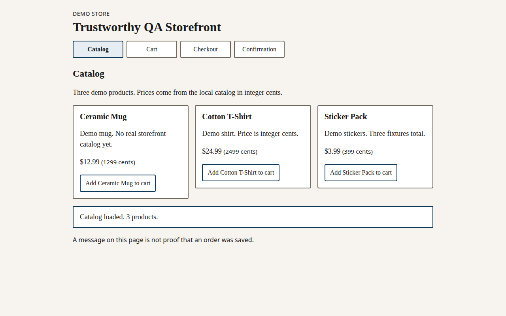
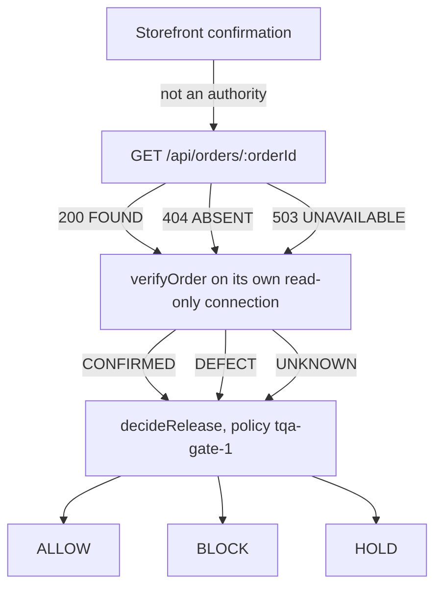
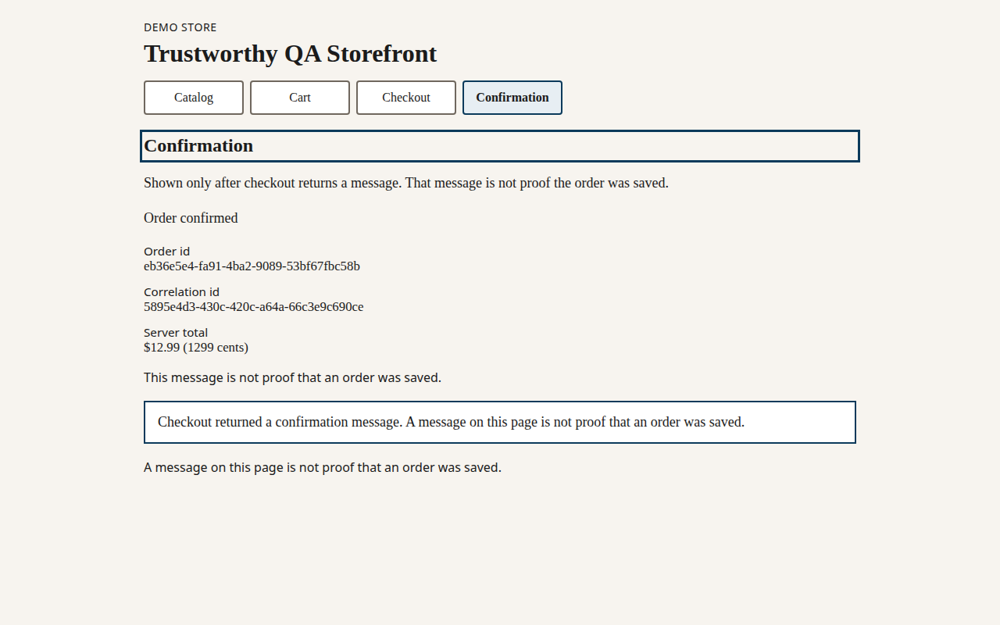
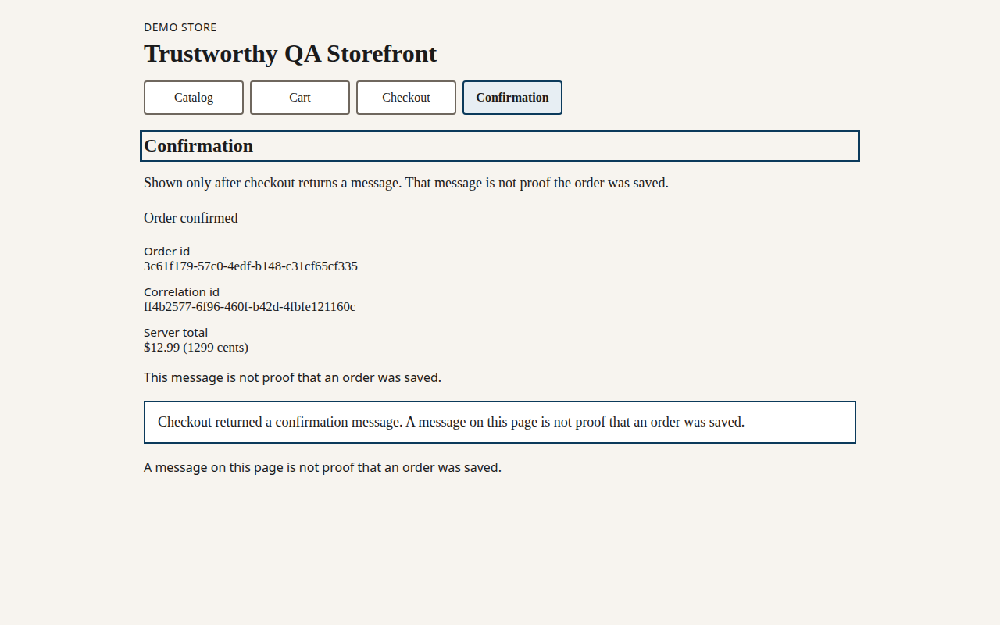
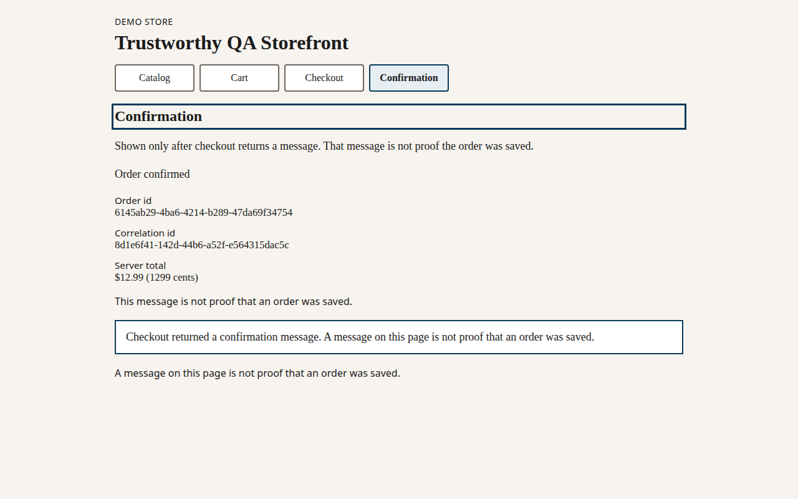

# Speaker slides — BrowserStack meetup draft

**Status:** DRAFT. Not sent. Do not submit this deck, the bio, or a headshot without an explicit human decision.  
**Talk:** Who Tests the AI That Tests Your Software?  
**Event:** BrowserStack Online Meetup, 2026-11-25.  
**Audience:** Manual QA and SDET practitioners with about 2–5 years of experience.  
**Lengths:** a 12-minute demo is planned inside about 35 minutes of content. Neither length has been rehearsed. This deck identifies the backup recording `docs/speaker/rehearsal/backup-recording.webm`. S-008 is not complete.  
**Captures:** `docs/speaker/captures/observations.json`, taken `2026-11-10T22:33:43.412Z`. `modelInvoked` is false. The attached diagnosis is `scripted-for-slide`, not a live model result.

---

## Slide 1. Who tests the AI that tests your software?

A checkout screen can say the order succeeded while the order was never stored. A model can explain that result in confident language and still be wrong.

Speaker note: Say the title and the two sentences. Do not introduce a measured model score. The proposal in `docs/speaker/2026-11-25-browserstack-draft.md` is still unsent, and its bio placeholders stay placeholders.

---

## Slide 2. A passing screen is weak evidence

The storefront shows a confirmation after checkout returns a message. That page does not call `GET /api/orders/:orderId`. The page says the message is not proof the order was saved.

The same confirmation text appears for `NORMAL`, `GHOST_SUCCESS`, and `VERIFICATION_UNAVAILABLE`: `Order confirmed`. The note on the confirmation is `This message is not proof that an order was saved.`

Speaker note: Point at the three confirmation captures before explaining the reads. The audience should see that the screen does not reveal the fault mode.

---

## Slide 3. Three outcomes, kept separate

| Mode | What the independent read means | Verification | Gate, policy `tqa-gate-1` |
|---|---|---|---|
| `NORMAL` | The order row is stored and the total matches its lines | `CONFIRMED` | `ALLOW` |
| `GHOST_SUCCESS` | The screen succeeded and the order row is absent | `DEFECT` | `BLOCK` |
| `VERIFICATION_UNAVAILABLE` | The authoritative read did not complete. A 503 or a timeout is not a 404 | `UNKNOWN` | `HOLD` |

`HOLD` is not a softer `BLOCK`. It means the release decision is not known yet.

Speaker note: Read the three rows. Do not collapse unavailable into missing.

---

## Slide 4. The screen did not change

These three checkouts each placed one Ceramic Mug. The server total shown on every confirmation was 1299 cents. The order ids below are the ids in the capture file and in the screenshots.

| Mode | Screenshot | Order id |
|---|---|---|
| `NORMAL` | [confirmation-normal.png](captures/confirmation-normal.png) | `eb36e5e4-fa91-4ba2-9089-53bf67fbc58b` |
| `GHOST_SUCCESS` | [confirmation-ghost.png](captures/confirmation-ghost.png) | `3c61f179-57c0-4edf-b148-c31cf65cf335` |
| `VERIFICATION_UNAVAILABLE` | [confirmation-unavailable.png](captures/confirmation-unavailable.png) | `6145ab29-4ba6-4214-b289-47da69f34754` |

NORMAL: lookup 200 FOUND, verification CONFIRMED, gate ALLOW.  
GHOST_SUCCESS: lookup 404 ABSENT, verification DEFECT, gate BLOCK.  
VERIFICATION_UNAVAILABLE: lookup 503 UNAVAILABLE service_unavailable, verification UNKNOWN, gate HOLD.

Speaker note: The ids are from this capture only. Another run will mint new ids. The matrix is the stable part.

---

## Slide 5. What the catalog actually is

The catalog is three local fixtures: Ceramic Mug, Cotton T-Shirt, and Sticker Pack. Prices are integer cents. The form does not collect a name, an address, or a payment. There is no scenario switch on the page. Fault injection stays on the local harness.

Speaker note: Say that this is demo data. Do not imply a real shopper or a real charge.

---

## Slide 6. Separate roles

The investigation agent can read evidence through five read-only tools. It does not open SQLite, approve a release, or change this policy. A diagnosis is not the gate.

Speaker note: Trace one arrow at a time. Stop on the sentence that the model does not approve the release.

---

## Slide 7. NORMAL: the screen and the row agree

The capture's normal order was found. `verifyOrder` returned `CONFIRMED`. `decideRelease` returned `ALLOW` with `VERIFICATION_CONFIRMED`. A scripted `SUCCESS` diagnosis whose text was `The confirmation screen says the order succeeded.` left the gate at `ALLOW`. That script did not call a model.

Speaker note: This is the path where a UI pass and the stored order agree. Agreement here does not make the other two screens trustworthy.

---

## Slide 8. GHOST_SUCCESS: the screen passes, the order is absent

The capture's ghost order was not in the order table. The lookup was `404 ABSENT`. `verifyOrder` returned `DEFECT`. `decideRelease` returned `BLOCK`. The same scripted `SUCCESS` diagnosis stayed `BLOCK`, and the reason codes were `VERIFICATION_DEFECT` and `DIAGNOSIS_IGNORED`.

GHOST_SUCCESS with scripted SUCCESS stayed BLOCK (VERIFICATION_DEFECT, DIAGNOSIS_IGNORED).

The limited UI check can still pass, because it never reads the order. The separate ghost oracle still expects HTTP 200. On this fault that expectation fails. The assertion was not rewritten to expect 404.

Speaker note: Call this an expected negative result, not a test to be silenced. The UI pass is real and insufficient.

---

## Slide 9. VERIFICATION_UNAVAILABLE: the read did not finish

The capture's unavailable lookup was `503` with reason `service_unavailable`, code `UNAVAILABLE`. It was not `404 ABSENT`. `verifyOrder` returned `UNKNOWN`. `decideRelease` returned `HOLD`. The scripted success diagnosis stayed `HOLD` with `VERIFICATION_UNKNOWN` and `DIAGNOSIS_IGNORED`. A second scripted `SUCCESS` diagnosis whose text was `Treat this 503 as a confirmed missing order.` also stayed `HOLD`. It did not become `BLOCK`.

VERIFICATION_UNAVAILABLE with a scripted missing-order claim stayed HOLD (VERIFICATION_UNKNOWN, DIAGNOSIS_IGNORED).

Speaker note: Ask the room what they would file. The point of the slide is that a failed lookup is not yet a missing order.

---

## Slide 10. Five measured regression runs

`fixtures/regression-baseline/baseline.json` is version `tqa-regression-baseline-2`.

Five measured regression runs and five measured expected-negative runs on this machine. This is not a release decision, not a model score, and not a flakiness rate for any other environment.

`pnpm test:e2e` ran five times. Regression exit codes 0, 0, 0, 0, 0. Each run passed the same seven tests, including the limited `GHOST_SUCCESS` confirmation, the normal oracle, the 503 oracle, the ghost absence control, and five consecutive normal checkouts inside the repeatability spec.

`pnpm test:e2e:ghost-oracle` ran five times. Ghost-oracle exit codes 1, 1, 1, 1, 1. Ghost-oracle lookup statuses 404, 404, 404, 404, 404. The ghost-oracle assertion still expects HTTP 200. Those five failures stay expected negative results. A green regression run is not `ALLOW`.

Speaker note: Read the limitation sentence aloud. Do not turn five local runs into a flakiness percentage. Durations stay in the baseline file and are not a rate.

---

## Slide 11. Twelve scripted labels are not a model score

`tests/evals/runner.ts` compared the checked-in stimuli in `tqa-golden-v1` with policy `tqa-gate-1`. The report says `measuredFromModel` is false and `modelInvoked` is false.

n=12. These counts are not a reliability rate and do not generalize. The runner did not call a model and did not open SQLite. measuredFromModel records only the caller-supplied source. Scripted stimuli do not include collected evidence ids, so an empty citation is uncovered rather than a measured linkage rate.

classification match 8, mismatch 3, abstained 1.  
evidence coverage covered 0, uncovered 11, not applicable 1.  
abstention appropriate 1, inappropriate 0.  
critical defects detected 2, missed 2.  
gate match 12, consistent 12.

The two ghost cases whose scripted candidate says `SUCCESS` stay diagnosis mismatches. Their gate stays `BLOCK`. A 503 or a timeout stays `UNKNOWN` / `HOLD`.

O-001 through O-007 remain UNVERIFIED. `pnpm test` does not score them. This deck does not mark any probe PASS or FAIL.

Speaker note: If someone asks for accuracy, show this limitation instead of a percentage.

---

## Slide 12. A 12-minute demo is planned, not rehearsed

| Planned minutes | What can be shown from the repo today | What this deck does not claim |
|---|---|---|
| 0–2 | The three confirmation screens, which look alike | A timed rehearsal |
| 2–6 | Normal read, `CONFIRMED`, `ALLOW` | A live model accuracy rate |
| 6–9 | Ghost screen pass beside `404 ABSENT`, `DEFECT`, `BLOCK` | That the ghost oracle was changed to pass |
| 9–11 | `503` `service_unavailable`, `UNKNOWN`, `HOLD` | That a 503 is a missing order |
| 11–12 | The baseline limitation and the scripted eval limitation | A measured spoken delivery |

The backup recording is `docs/speaker/rehearsal/backup-recording.webm`. The video is the confirmation screen. It is not the order lookup and it is not a release decision.

Speaker note: Offer to stop at the ghost contrast if time is short. Do not invent a recording if the live path fails.

---

## Slide 13. Sources

- `docs/spec.md` — S-001, S-002, S-003, and S-008. S-008 still needs a timed rehearsal. The backup recording is `docs/speaker/rehearsal/backup-recording.webm`.
- `docs/architecture-contracts.md` — decision matrix and the rule that a 503 is not a 404.
- `docs/intent.md` — a UI pass and a model diagnosis are not persistence proof.
- `docs/speaker/captures/observations.json` — the three reads, the validator statuses, and the gate decisions from this capture. `capturedAt` is `2026-11-10T22:33:43.412Z`.
- `fixtures/regression-baseline/baseline.json` — `tqa-regression-baseline-2`.
- `fixtures/golden-dataset/cases.json` — twelve human-authored labels, `measuredFromModel` false.
- `tests/evals/runner.ts` — the scripted counts on slide 11.
- `docs/speaker/2026-11-25-browserstack-draft.md` — unsent abstract, agenda, and bio checklist.

Speaker note: If a question cites a number that is not in this list, do not supply one from memory.

---

## Slide 14. Close

The release decision stays with the independent read and policy `tqa-gate-1`. The screen can pass in all three modes. The model, when one is used, does not approve the release.

Still open for a human: the speaker name, role, experience, contact, and a headshot kept outside this repository. Sending the proposal is a separate decision. The 54-hour baseline and the 9-hour contingency are unchanged.

Speaker note: Leave time for questions. Do not announce that the materials have been sent.

---
